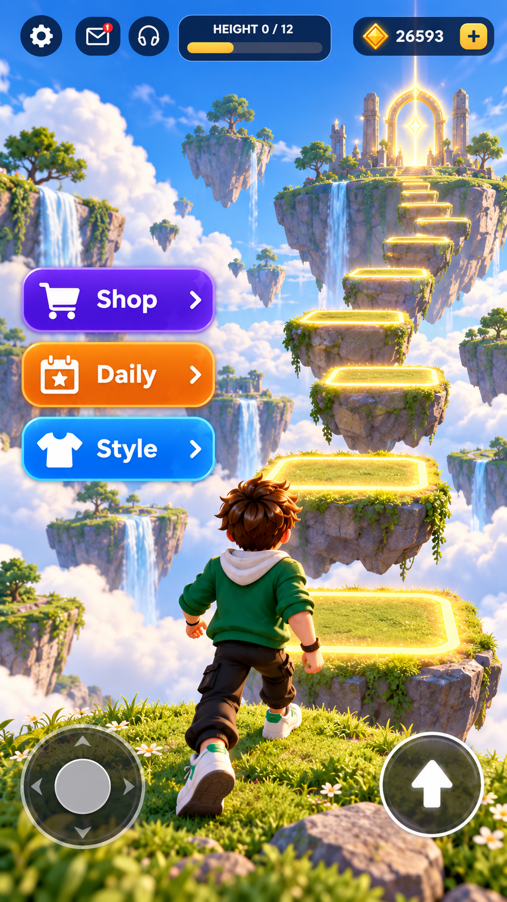

# Rising Steps Art Direction

## Target
Bright fantasy sky realms that remain feasible on mobile: authored grass/rock islands, warm gold route glow, cyan sky, soft clouds and one portal focal point.

## Palette
- Sky cyan: #47A9FF
- Cloud: #F5FBFF
- Grass: #68A94C
- Rock: #6E687E
- Gold route: #FFD43D
- Purple Shop: #7A35F5
- Orange Daily: #FF8A1E
- Blue Style: #1598FF
- Navy UI: #0A2342

## World
- 12 clear platforms per realm.
- Larger destination island and glowing portal.
- Decorative islands/waterfalls remain non-colliding.
- Final production art uses optimized authored meshes and atlas materials.

## UI
Top-left: settings, inbox, audio.
Top-center: Height 0/12 progress.
Top-right: crystal currency.
Left middle: Shop, Daily, Style.
Bottom: joystick left, jump right.
The center route remains unobstructed.

## Primary visual reference

This image is the binding visual target for the sky-realm palette, floating-island silhouettes, vegetation, waterfalls, route glow, portal/temple destination and HUD hierarchy. It is not permission to keep Shop, Daily and Style permanently over gameplay; these are contextual controls/panels and the climb route must remain clear.

### Non-negotiable visual gates
- Islands must read as authored grass/rock landforms, not block platforms.
- Decorative vegetation and waterfalls create scale while remaining non-blocking and mobile-budget aware.
- Gold route lighting identifies the climb; the sky stays bright, soft and optimistic.
- The destination temple/portal must remain a visible long-range focal point.
- Character, islands and UI require a coherent non-Roblox visual language.

## 2026-10-09 menu correction
The home is a bright sky atlas: cream surfaces, dark green ink, cyan illustrated islands, and one fixed warm-gold Continue/Start action. Each realm has its own grass, waterfall or temple preview and actual stars/unlock state. Secondary destinations are paired adventure tiles, not a uniform vertical stack of blue pills. Context pages use the same cream/ink palette with restrained category accents. Main gameplay keeps its center clear; deliberate camera orbit belongs to the small View pad on the left edge, outside the route. Hands-on tutorial guidance occupies the unused gap between the movement and jump controls, with a compact edge fallback in a narrow reserved pane.

Native compact inspection rejected overlapping hero lettering and repeated flat island diagrams. Revised gallery uses the existing painted panorama's distinct meadow/waterfall subjects and the authored adventurer/temple icon. Hero text and artwork occupy disjoint columns with a4%gutter. Gallery uses10unit corner radii, flat cream surfaces and a subtle1unit dark edge; the gold accent is reserved for Continue.

## 2026-10-09 realm scenery revision
Realm choice rebuilds both route islands and owned distant scenery. Meadow retains limestone, grass and trees. Cascade adds cool cliffs, azure edge pools/lilies and broader recurring falls. Temple replaces grass caps and falls with sandstone paving, carved perimeter columns and distant ruined lintels. Decorative additions have no colliders and remain outside the landing ring; the same deterministic course geometry remains authoritative. Sky/cloud materials belong to the rebuilt scenery root; old roots disable immediately and release their meshes/materials on destruction. This is a practical mobile art step toward the concept, not a claim that concept-quality rendering or physical-device performance is fully accepted.

## Approved October 10 world direction

The approved three-view board is `rising-steps-3-ansichten.png`, retained in the owned October 10 concepts delivery directory. It supersedes the old primary image for this revision; the user's deletion of `docs/concepts/PRIMARY-CONCEPT.png` is preserved.

Keep the current cream/green illustrated atlas readable: separate hero copy and art, actual stars/unlock state, short DE/EN descriptions, and a fixed gold Continue action. Gameplay comes from real island, flora and architecture meshes, rather than a painted world in the skybox.

- **Meadow Sky:** pale limestone, a green landing cap with perimeter grass and daisies, rounded tree crowns, clear blue gradient sky. Water gardens and falls belong to the water realm.
- **Waterfall Realm:** pale mineral landing caps, terraced cliff shoulders, turquoise shallow perimeter pools, segmented lily pads and petal blossoms, reeds, layered waterfall ribbons and foam. Its larger distant cliffs have their own layout. No meadow grass, daisies or tree kit.
- **Temple Trail:** dry ochre stone landforms, paving joints, perimeter carved friezes, fluted columns with gold bands, stairs, purple banners, broken lintels and fallen stone. Warm sun and lavender/peach sky. No grass/daisies, trees, pools or falls.
- **Destination:** a genuine thick segmented masonry arch, jambs, gold carvings/keystone and cornice; portal arrival behavior remains unchanged.

The deterministic landing fan and its collision remain unchanged. Scenic additions have no colliders and share the existing cached atlas materials/static batch boundary. Generated original/batched meshes and per-world sky/cloud materials remain owned by their roots. Each waterfall caches its ribbon renderers and uses one property-block driver; reduced motion suppresses the shimmer.

This is an achievable mobile geometry direction. Source checks and image similarity do not establish physical frame rate, thermal behavior, genuine commerce, or full cinematic equivalence to the board. The coordinated actual player screenshots and course gate must be inspected before visual acceptance.

## 2026-10-14 contour and portal revision

The user-authorized full Concept rebuild now permits growing first-three-world landing outlines. Course centers, heights, data slots and RNG consumption remain unchanged; the new fan must independently contain the whole former safe polygon and match its rendered terrain/cliff lips. Water uses a wider mineral shelf, Temple a rounded square and corresponding masonry/inlay. Broad eroded Water/Temple bases replace the former all-world pointed-base requirement. The arched radiance is an actual 3D mesh with one parent-owned warm point light; original arrival logic remains. Exact-source native earned100courses/1200landings/100portals and save reloading pass. This is functional geometry acceptance, not overall Concept acceptance; see QA/rising-landforms-portal-20261014.json.

## 2026-10-14 coordinated depth and daylight

Original stratified limestone, real beveled sediment beds and denser first-three-world highlands remain within30kroute/70khorizon/12material/5texture ceilings. The portrait composition is judged in the real player framebuffer, not inferred from mesh presence or projected coordinates; the bank is partly visible, and richer integrated foliage/architecture remains open. The world-name tab and live controls use the approved compact cream/dark-glass visual language with48point accessible targets. Actor UV smoothing preserves opposing cloth normals and original joint/style ownership. Bounded filmic daylight rendering replaces clipping camera highlights; original Gamma color space and existing pipeline stay intact. No DOF blur is applied to playable landings. Actual HDR/linear/Gamma GPU fixtures and native behavior pass, while overall visual acceptance remains failed. See QA/rising-depth-strata-light-20261014.json for exact-source evidence and limits.

2026-10-14 coherent Waterfall reconstruction: original modeled valley water below existing landing fans, five planted eroded banks and wide waterfalls; retained actual route collider/RNG/portal authority and mobile geometry ceilings. Independent CascadeFlow original asset and actual water shader. Five native review modes plus100earned courses/cold100scores pass on frozen2b147f. Actual Concept comparison remains below target: further botanical density/composition and runner quality required. Menu pictures never stand in for gameplay.

## 2026-10-14 original terraced Temple sanctuary

Temple's repeated scaled scenic landing templates now give way to genuine larger terraced ruins, carved fluted columns, dry planted banks, raised banner ornaments, thick gateway and background mountains. Same authoritative playable islands and movement remain. Real sunset geometry and directional key agree; one bounded shadowless fill keeps the front of the boy and stone readable, without lighting isolated UIstudio geometry. Native comparisons are unpainted current player framebuffers. Original landscape texture surfaces, ten individual chapter pictures and persistent own Unity adventurer assets are real integrated resources; they do not by themselves establish approved Concept likeness. Further character/landform/botanical/material detail remains, and the visual release gate stays FAILED.

## 2026-10-14 — actual square Temple route and original persisted architectural models

The user explicitly rejects the actual small-island Temple path. Temple now uses three own editable Unity prefabs (4.2m regular square,5.2m plaza,6m destination) and one persistent491mesh library. The square collider itself and the visible nine paved slabs share the unchanged0.6m roof elevation; all former seeded safe points remain inside. No Temple LimestoneCliff/tapered island body remains. Centers/heights/seeds/save IDs and natural silhouettes of the other nine realms stay unchanged. The earlier generic no-block/organic-island direction applies to natural realms; the approved Temple and explicit user correction require genuinely rectilinear architecture.

Own generated TempleSandstone-v1 diffuse albedo is retained byte-for-byte with prompt/hash provenance. Original carved piers/masonry/friezes, fluted columns, purple sun banners and folded-leaf/three-dimensional-floret dry herb shelves form actual editable model components. Stone/floor shaders use the original albedo, owned normal response and8ray real model-visibility occlusion baked in the actual Editor; no per-frame geometry rays. Runtime borrows immutable library meshes and uses two shared owned course masonry materials; explicit/disabled-renderer cleanup fixtures protect those resources. The three variants have7018/7934/7934vertices beneath the14k model ceiling. Existing30k route/70k background/12material/5texture ceilings remain unchanged.

A broad continuous modeled ruined foundation covers the actual complete route below the scored roofs. It has no colliders; Temple-only early fall recovery prevents descending into this decorative mass. Genuine native edge-fall clearance is measured separately. This recovery change is deliberate; camera ownership, motor, campaign/rule/portal authority remain. Expanded high destination roofs require earlier QA jump input: a recorded old-agent late launch stops before its fixed0.72m threshold, while the real existing Jump button reaches the correct roof. Final QA uses Temple-only XZ proximity to the next real collider and separately proves each real Motor.Jumped/current-target Landed event with grounded starts. The diagnosed witness build never stands in for final passing evidence.

Comparison uses actual unpainted current player frames beside the unchanged approved Oct10 Concept. Square Temple composition is implemented; overall Concept acceptance remains FAILED because actor/hair quality, material/plant richness and sunset atmosphere still need work. Main menu identity remains pending; functionality alone is never approval. No TestFlight/version bump or device-FPS/real-ad/commerce claim. Continue graphical work on Rising before RepairEmpire, then the withdrawn PerfectDrop correction.
